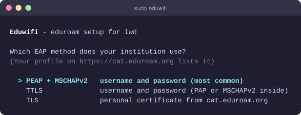
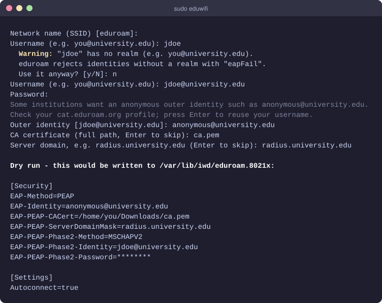
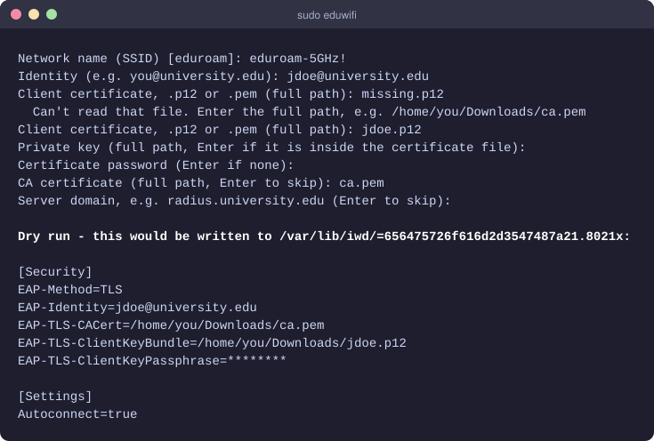
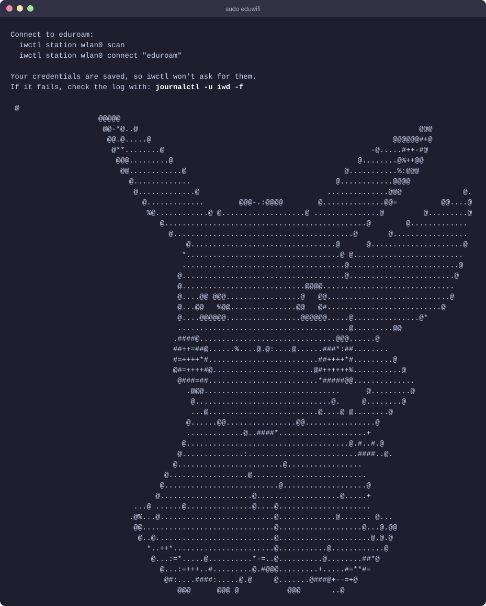

<h1 align="center">Eduwifi</h1>

<p align="center">
  Set up <strong>eduroam</strong> (or any WPA2/WPA3-Enterprise network) for
  <a href="https://iwd.wiki.kernel.org/">iwd</a> from a friendly terminal menu.
</p>

<p align="center">
  
  
  
</p>

<p align="center">
  
</p>

Writing an iwd `.8021x` profile by hand means getting a dozen `EAP-*` keys exactly
right. Eduwifi asks a few questions and writes the profile for you, with only root
able to read it. It can also randomize your MAC address first.

## Features

- **PEAP, TTLS and TLS.** Covers the EAP methods eduroam institutions use, including
  certificate-based logins from [eduroam CAT](https://cat.eduroam.org).
- **Anonymous outer identity.** Sends `anonymous@your.realm` before the encrypted
  tunnel when your institution asks for it.
- **Server verification.** Optionally pins your institution's CA certificate and
  RADIUS server domain so you don't send your password to a fake access point.
- **Catches common mistakes.** Warns when a username has no `@realm`, which is the
  most common cause of `eapFail` on eduroam.
- **Safe defaults.** The profile is created with `0600` permissions, interface names
  are validated, and SSIDs with special characters are stored the way iwd expects.
- **Dry run.** `eduwifi -n` shows the profile it would write, with secrets masked,
  without root.
- **MAC randomization.** Optional, through `macchanger`.

## Requirements

- Linux with `iwd` running and NetworkManager / wpa_supplicant not managing the card
- `gcc` and `make` to build
- `macchanger` (only for the MAC randomization option)

| Distribution  | Install dependencies                          |
| ------------- | --------------------------------------------- |
| Arch Linux    | `sudo pacman -S iwd gcc make macchanger`      |
| Fedora        | `sudo dnf install iwd gcc make macchanger`    |
| Debian/Ubuntu | `sudo apt install iwd gcc make macchanger`    |

Then make sure iwd is running:

```bash
sudo systemctl enable --now iwd
```

## Installation

```bash
git clone https://github.com/lcoronelr/eduroam-iwd-connector.git
cd eduroam-iwd-connector
make
sudo make install
```

This installs `eduwifi` to `/usr/local/bin`. Use `PREFIX=/usr` to install elsewhere.

## Usage

```bash
sudo eduwifi                 # interactive setup
sudo eduwifi -i wlp2s0       # pick the wireless interface (default: auto-detect)
eduwifi -n                   # dry run: print the profile instead of writing it
```

Use the **arrow keys** and **Enter** in the menus, then answer the prompts.

### 1. Find your institution's settings

Every institution configures eduroam slightly differently. Look yours up on
[cat.eduroam.org](https://cat.eduroam.org) and download the **Linux** installer.
It is a Python script, and near the top you'll find:

| What to look for                                  | Where Eduwifi asks for it                    |
| ------------------------------------------------- | -------------------------------------------- |
| EAP method (`PEAP`, `TTLS` or `TLS`)              | EAP method menu                              |
| Inner method (`MSCHAPV2` or `PAP`)                | TTLS inner method menu                       |
| Anonymous identity, e.g. `anonymous@…`            | *Outer identity*                             |
| CA certificate (`-----BEGIN CERTIFICATE-----`)    | *CA certificate* (save it as a `.pem` file)  |
| Server name, e.g. `radius.university.edu`         | *Server domain*                              |

If your institution uses certificates (EAP-TLS), CAT gives you a personal `.p12`
file. Choose **TLS** and point Eduwifi at it.

### 2. Run Eduwifi

<p align="center">
  
</p>

<details>
<summary>Certificate-based login (EAP-TLS)</summary>
<p align="center">
  
</p>
</details>

### 3. Connect

```bash
iwctl station wlan0 scan
iwctl station wlan0 connect eduroam
```

Your credentials are already saved in the profile, so iwctl won't ask for them.
Replace `wlan0` with your interface (`iwctl device list` shows it). iwd also
reconnects automatically from now on.

<p align="center">
  
</p>

## What gets written

Eduwifi writes `/var/lib/iwd/<SSID>.8021x`, for example for PEAP:

```ini
[Security]
EAP-Method=PEAP
EAP-Identity=anonymous@university.edu
EAP-PEAP-CACert=/home/you/Downloads/ca.pem
EAP-PEAP-ServerDomainMask=radius.university.edu
EAP-PEAP-Phase2-Method=MSCHAPV2
EAP-PEAP-Phase2-Identity=you@university.edu
EAP-PEAP-Phase2-Password=your-password

[Settings]
Autoconnect=true
```

See `man iwd.network` for every available option. Keep certificate files where you
saved them, because iwd reads them each time it connects.

## Troubleshooting

Watch iwd's log while connecting:

```bash
journalctl -u iwd -f
```

| Log message | Likely cause and fix |
| ----------- | -------------------- |
| `EAP negotiation stopped after the Identity exchange` / `eapFail` | The server rejected your identity before checking the password. Use your full username with realm (`you@university.edu`), set the anonymous outer identity from CAT, and check the EAP method matches your institution. |
| `4-Way handshake failed ... reason: 23` | 802.1X authentication failed. See the line above, or re-check your password. |
| Connection fails right after the TLS handshake | Wrong CA certificate or server domain. Re-run without them to confirm, then copy them from CAT again. |
| `Permission denied` writing the profile | Run with `sudo`. |
| `Failed to change MAC address` | Install `macchanger`, or choose *Set credentials only*. |

To start over, delete the profile and run Eduwifi again:

```bash
sudo rm /var/lib/iwd/eduroam.8021x
```

## Uninstall

```bash
sudo make uninstall
```

## Contributing

Bug reports and pull requests are welcome. When opening an issue, please include
your distribution, iwd version, the EAP method from your CAT profile, and the output
of `journalctl -u iwd`. **Never post your password or certificate files.**

## License

[MIT](LICENSE) © Luis Coronel
